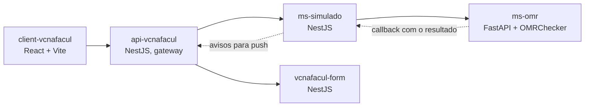

# Arquitetura

Como os serviços do Você na Facul conversam, onde guardam dados e como rodam. Sem hostnames, IPs ou
credenciais. Um card que muda algo daqui atualiza este arquivo.

## Quem chama quem

- **client → api**: o frontend só fala com o gateway.
- **api → ms-simulado** (`SIMULADO_URL`) e **api → vcnafacul-form** (`FORMULARIO_URL`): proxy HTTP. Os dois
  microsserviços não são expostos ao público.
- **ms-simulado → ms-omr** (`OMR_URL`): `POST /omr/process` com a chave da imagem responde `202` na hora e
  enfileira a leitura.
- **ms-omr → ms-simulado** (`CALLBACK_URL`): o resultado da leitura volta por callback, em
  `v1/cartao-resposta/callback`.
- **ms-simulado → api** (`API_URL`, com `NOTIFICACAO_SECRET`): avisos de resultado e de fim de recálculo,
  que viram notificação push.
- O `vcnafacul-form` não chama nenhum outro serviço.

## Onde ficam os dados

| Serviço | Banco | Fila e cache | Arquivos | Porta local |
|---|---|---|---|---|
| `api-vcnafacul` | MySQL (MariaDB em produção) | Redis, quando `CACHE_DRIVER`/`QUEUE_DRIVER` pedem; memória por padrão fora da stack | S3 ou compatível | `3333` |
| `ms-simulado` | MongoDB (replica set `rs0`) | Redis, quando `QUEUE_DRIVER` pede | S3 ou compatível | `3000` |
| `ms-omr` | nenhum (stateless) | Redis (fila arq e cache de imagem) | lê do S3 ou compatível | `8000` |
| `vcnafacul-form` | MongoDB | — | — | `3001` |
| `client-vcnafacul` | — | — | — | `5173` |

Bucket: MinIO no modo local, Cloudflare R2 em produção. Fila em produção: Valkey, com persistência.
MongoDB em produção: Atlas.

## Serviços externos

| Serviço | Usado por | Para quê |
|---|---|---|
| Firebase | api, client | Notificações push |
| SMTP | api | E-mail (no desenvolvimento, sempre Mailpit) |
| Google | api, client | Login OAuth e Maps |
| Anthropic / OpenAI | api | Correção de redação (`ESSAY_AI_PROVIDER`) |
| Discord | api | Webhook de avisos |
| Grafana (Loki) | api | Logs |
| FTP | api | Envio e remoção de arquivos (`uploadFileFtp`) |

## Ambientes

Tudo roda pelo `vcnafacul-stack`. Detalhes no README dele.

| Ambiente | Como sobe | Bancos e bucket |
|---|---|---|
| Local | `make up`, ou `make infra` só para a infraestrutura com os apps no host | Containers locais |
| Local apontando para homol | `make up-homol` (**tudo o que você fizer escreve em homol**) | Os do `.env` de cada repo |
| Servidor de homol | `./deploy.sh` | Arquivos de ambiente do servidor |
| Servidor de produção | `./deploy.sh` com `.ambiente=prod` | Arquivos de ambiente do servidor |

`make up`, `make infra` e `make up-homol` usam nomes fixos de projeto do compose (`vcnafacul-local`,
`vcnafacul-homol`) e trocar de modo derruba o outro. **Duas cópias da stack na mesma máquina dividem os
mesmos containers e volumes.**

## Ordem de deploy

Quem produz o dado vai antes de quem consome: **ms-omr / ms-simulado / vcnafacul-form → api → client**. Toda
exceção é registrada, com o motivo, em `## Ordem de deploy` no README do ticket.
